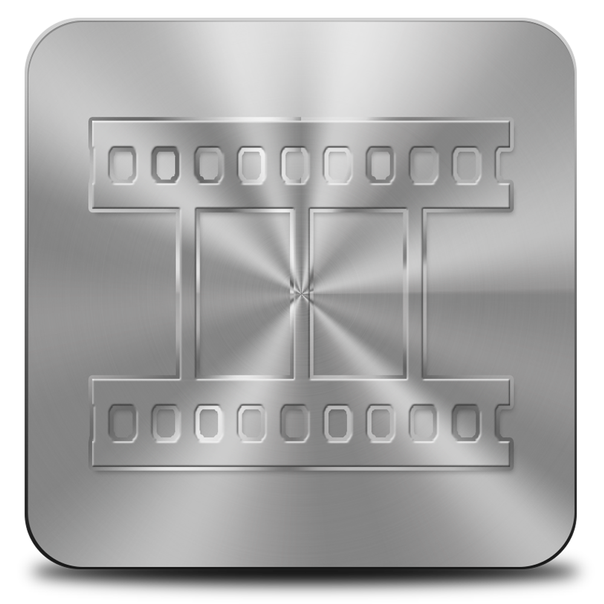

<p align="center">
  
  <h1 align="center">Perfect Grid</h1>
</p>

<p align="center">
  <a href="https://github.com/worstgirlinamerica/PerfectGrid/releases/latest">
    
  </a>
  
  
</p>

<p align="center">
  <a href="docs/README.zh.md">中国語</a> &nbsp;|&nbsp;
  <a href="docs/README.pt.md">ポルトガル語</a> &nbsp;|&nbsp;
  <a href="docs/README.es.md">スペイン語</a> &nbsp;|&nbsp;
  <a href="docs/README.ja.md">日本語</a> &nbsp;|&nbsp;
  <a href="docs/README.fr.md">フランス語</a> &nbsp;|&nbsp;
  <a href="docs/README.de.md">ドイツ語</a> &nbsp;|&nbsp;
  <a href="docs/README.ko.md">韓国語</a> &nbsp;|&nbsp;
  <a href="docs/README.ar.md">アラビア語</a>
</p>

Perfect Gridは、ローカルの動画ファイルから動画コンタクトシートやプレビューサムネイルを作成するための、無料のオープンソースデスクトップアプリです。動画をドラッグ＆ドロップし、レイアウトを選択するだけで、高品質なPNG形式のコンタクトシートをエクスポートできます。

編集者、コレクター、アーキビスト、そして動画の概要を素早く視覚的に把握したいすべての方のために開発されました。

<p align="center">
  
  <br>
  <em>Perfect Gridで生成されたコンタクトシートの例。</em>
</p>

<p align="center">
  <a href="https://github.com/worstgirlinamerica/PerfectGrid/releases/latest">
    
  </a>&#8203; &nbsp;
  <a href="https://github.com/worstgirlinamerica/PerfectGrid/releases/latest">
    
  </a>&#8203; &nbsp;
  <a href="https://github.com/worstgirlinamerica/PerfectGrid/releases/latest">
    
  </a>
</p>

## 機能

- 高度な動画メタデータ（解像度、コーデック、再生時間、ファイルサイズなど）を表示した高品質なコンタクトシートを生成
- 完全にカスタマイズ可能なグリッドレイアウト
- オプションでタイムコードのオーバーレイ表示
- **Refine Picks** によるスマートなフレーム選択
- カスタムプリセットの保存と再利用
- バッチ処理
- Windows、macOS、Linuxで動作

> どのようなエラーが発生した場合でも、動作しない箇所がある場合、またはご質問がある場合は、[Issue](https://github.com/worstgirlinamerica/PerfectGrid/issues/new)を作成して報告してください。

## 基本的な使い方

1. Perfect Gridを開きます。
2. 動画をウィンドウにドラッグします。
3. グリッドのレイアウトとスタイルを調整します。レイアウトを変更した場合は、**プレビューの更新**をクリックしてサムネイルを再生成してください。
4. プレビューの画質は意図的に低く設定されています。エクスポート時には、選択した画質設定が常に適用されます。
5. （オプション）**Range** タブで、**Refine Picks** を使用すると、よりスマートにフレームを選択できます。
6. **Range** でエクスポート品質を選択します：**Fast (1080p)**、**Detail (1440p)**、または **Maximum (4K)**。
7. **PNGとしてエクスポート**をクリックします。

## インストール

[リリース](https://github.com/worstgirlinamerica/PerfectGrid/releases/latest) ページから、お使いのOSに対応した最新リリースをダウンロードしてください。

### macOS

1. [最新リリース](https://github.com/worstgirlinamerica/PerfectGrid/releases/latest) から macOS 用の zip ファイルをダウンロードします。
2. ダブルクリックして解凍し、Perfect Grid を「アプリケーション」フォルダにドラッグします。
3. `Perfect Grid.app` を開きます。

> 署名されていないため、macOSは初回起動時にアプリをブロックします。右クリック → **開く** → **開く** を選択してブロックを解除してください。それでも開かない場合は、ターミナルで次のコマンドを実行してください：`xattr -cr "/Applications/Perfect Grid.app"`

### Windows

1. [最新リリース](https://github.com/worstgirlinamerica/PerfectGrid/releases/latest)からWindows用のzipファイルをダウンロードします。
2. 右クリック → **すべて展開** を選択し、フォルダを開きます。
3. `Perfect Grid.exe` をダブルクリックします。

> アプリはコード署名されていないため、Windows SmartScreen から警告が表示される場合があります。**詳細情報** → **それでも実行** をクリックしてください。

### Linux

1. [最新リリース](https://github.com/worstgirlinamerica/PerfectGrid/releases/latest)からAppImageをダウンロードしてください。
2. 実行可能にして実行します：

```bash
chmod +x PerfectGrid-*-Linux-x86_64.AppImage
./PerfectGrid-*-Linux-x86_64.AppImage
```

インストールは不要です。FFmpeg およびすべての依存関係が同梱されています。ほとんどの x86_64 ディストリビューション（Ubuntu 22.04 以降、Fedora、Arch など）で動作します。

> FUSE エラーが発生した場合は、`sudo apt install fuse`（Debian/Ubuntu）または `sudo dnf install fuse`（Fedora）を実行してください。

## プライバシー

すべての処理はローカルで行われます。分析、テレメトリ、アップロードは一切行われません。FFmpeg と FFprobe が同梱されています。

## ローカライズ

アプリの UI は 8 言語に対応しています。シート上のファイル名の表示は別のシステムで処理されており、エクスポートされた PNG ファイル上にファイル名をピクセルとして描画するため、スクリプト固有のフォント処理が必要です。

| 言語 | UI | シート上 |
|---|---|---|
| 英語 | あり | あり |
| 中国語 (中文) | あり | あり (macOS、Windows) |
| ポルトガル語 (PT) | あり | あり |
| スペイン語 (ES) | あり | あり |
| 日本語 (JA) | あり | あり (macOS、Windows) |
| フランス語 (FR) | はい | はい |
| ドイツ語 (DE) | はい | はい |
| 韓国語 (KO) | はい | はい (macOS、Windows) |
| アラビア語 / RTL | — | はい |
| ヘブライ語 | — | — |
| タイ語 | — | — |
| デーヴァナーガリー文字（ヒンディー語など） | — | — |

> 現在、Linux における非 ASCII ファイル名の表示はサポートされていません。ラテン文字以外の文字で書かれたファイル名は四角いボックスとして表示されます。これは次回のリリースで修正される予定です！

## 注意事項

- MP4、MOV、MKV、AVI、WebM、および FFmpeg が読み込めるすべての形式に対応しています。
- 古いハードウェアでは、AV1 および VP9 のデコードに時間がかかる場合があります。
- macOS 向けビルドは署名されていません — 上記のインストールに関する注意事項を参照してください。

<details>
<summary>開発者向け</summary>

```bash
python -m pip install -r requirements.txt
PYTHONPATH=src python -m perfect_grid.app
```

ソースから実行する際、アラビア語/RTLファイル名を完全にサポートするには：

```bash
pip install arabic-reshaper python-bidi
```

ビルドスクリプトは `scripts/` ディレクトリにあります。GitHub Actions は、タグ付きプッシュ時に Windows および Linux 版を自動的にビルドします。macOS 版は手動でビルドされます。

</details>

## 貢献について

バグやエラーが発生した場合は、[Issue](https://github.com/worstgirlinamerica/PerfectGrid/issues/new)を作成してフィードバックをお寄せください。
記載していただくと特に役立つ情報として、お使いのOS、動画形式、および問題が「プレビュー」「リファイン」「エクスポート」、あるいは「バッチ」のどの段階で発生したかがあります。

詳細は [CONTRIBUTING.md](CONTRIBUTING.md) をご覧ください。

## ライセンス

MIT ライセンスです。[LICENSE](LICENSE) をご覧ください。
